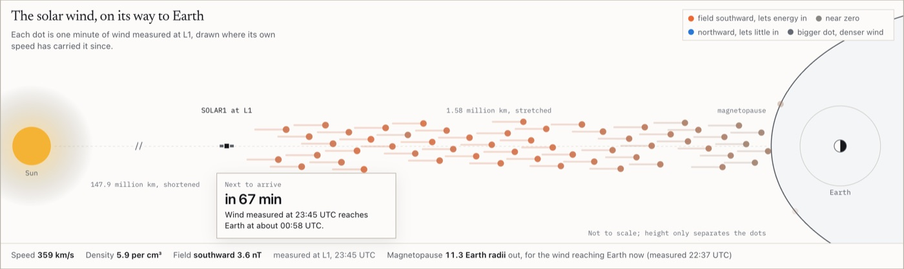

# space-weather-nowcast

A spacecraft about 1.5 million km toward the Sun measures the solar wind roughly an hour before it reaches Earth. This page follows that wind to Earth, shows how hard it presses on Earth's magnetic field, and maps the aurora against Syracuse, live from nine NOAA feeds.

**Live:** [tanaypratapsingh.github.io/live/sun.html](https://tanaypratapsingh.github.io/live/sun.html)

<picture>
  <source media="(prefers-color-scheme: dark)" srcset="docs/screenshot-dark.jpg">
  
</picture>

My [Kp forecasting project](https://github.com/TanayPratapSingh/multi-horizon-aurora-kp-prediction) trained an LSTM on hourly solar wind history from NASA's OMNI2 dataset. Clean history is the easy part. A model like that would run in production on the live feeds, which arrive from several spacecraft, at different cadences, with gaps, revisions and switches between instruments. This page builds that input side: it joins NOAA's real time feeds, propagates each measurement to Earth, turns them into the quantities that drive geomagnetic activity, and shows how fresh every input is.

## What it measures

| Card | Method |
| --- | --- |
| The solar wind, on its way to Earth | Each 1 minute plasma sample from the last 2 hours, placed by (now minus measurement time) times its own speed over the active spacecraft's real distance from the hourly ephemeris; colored by the direction of the magnetic field |
| How far out is Earth's magnetic shield? | Magnetopause standoff from Shue et al. (1998), drawn against geosynchronous orbit at 6.6 Earth radii |
| How much energy is getting in? | The Newell et al. (2007) coupling function, v^(4/3) Bt^(2/3) sin^(8/3)(theta / 2) |
| Is a geomagnetic storm coming? | Kp from the 1 minute estimate and NOAA's 3 day forecast, with the G scale; the forecast for the current 3 hour window is set against the live estimate |
| Is the Sun flaring? | GOES X-ray flux on a log scale with A to X flare classes |
| Could you see an aurora in the next hour? | OVATION probability on a north polar map, with the night side shaded from the computed subsolar point |
| Is the data current? | Every feed's newest sample age against a stated threshold |

## Measured on real data

One pass over all nine feeds at 19:38 UTC on October 8, 2026 (log in [`runs/`](runs/)) found the spacecraft labelled SOLAR1 active at 1.58 million km sunward. The latest joined sample showed 360 km/s and 5.7 protons per cubic centimetre, giving a dynamic pressure of 1.24 nPa, a magnetopause standoff of 10.9 Earth radii, and an arrival 73.5 minutes after measurement. Plasma covered 1,265 of the previous 1,435 minutes. The GOES record held an M6.7 flare at 15:48 UTC, and NOAA's forecast peaked at Kp 5.67, labelled G2, for 06:00 UTC on October 9.

## Things the feeds taught me

- **My spec was wrong about the G scale.** I had specified that Kp 4.67 counts as below G1. NOAA's own forecast file labels 4.67 as G1 and 5.67 as G2, because NOAA rounds Kp to the nearest whole number before mapping. The page follows NOAA, and both rules are implemented and tested.
- **NOAA rewrites recent minutes.** Two versions of the 1 minute Kp file fetched seconds apart disagreed about recent minutes. The page keeps the latest version of each minute and counts revisions, so a window's maximum can go down as well as up.
- **Hidden tabs.** Polling pauses while a tab is hidden, which meant a page opened in a background tab showed nothing until viewed. The first poll now always runs.

## Run it

```bash
python3 -m http.server 8000
```

Then open `http://localhost:8000`. ES modules do not load from `file://`. The aurora map loads d3-geo, topojson-client and the Natural Earth land outlines from jsDelivr, pinned to exact versions; every number is still computed if the CDN fails.

## Tests

```bash
node --test tests/*.test.mjs
```

20 tests on node 22 or newer, nothing to install. They check dynamic pressure, the Shue standoff, Newell coupling and the ballistic delay against closed forms, flare classes and both G scale rules (the NOAA rule reproduces the labels in NOAA's own file), the subsolar point at the 2026 equinox and solstice, the Sun's distance near perihelion and aphelion, the join of plasma and field for the active spacecraft with gaps and source changes, the OVATION lookups, and the feed freshness thresholds.

## Layout

```
index.html      the page
sun/helio.js    joins, propagation, pressure, coupling, Shue, G scale, flare class, subsolar point and OVATION helpers: pure, no DOM
sun/app.js      nine polls, the stage, charts, the magnetosphere and aurora map
assets/         shared styles, helpers, charts and the paint scheduler
tests/          node:test suite
runs/           log of the run quoted above
docs/           screenshots
```

## Limitations

- Ballistic propagation is approximate: solar wind fronts are tilted, so the real arrival can differ by several minutes.
- The Shue model is symmetric and ignores dipole tilt; it is an empirical fit, not a simulation.
- The feeds carry no archive of NOAA's earlier forecasts, so the page compares the current window's forecast with the live estimate instead of claiming a skill score.
- OVATION is read at the nearest one degree cell, and cloud and light pollution are not modelled.

## Data

NOAA Space Weather Prediction Center JSON products, public domain. Spacecraft names are shown exactly as the feed labels them.

Part of the [live data dashboards](https://tanaypratapsingh.github.io/live/) on my portfolio. MIT licensed.
